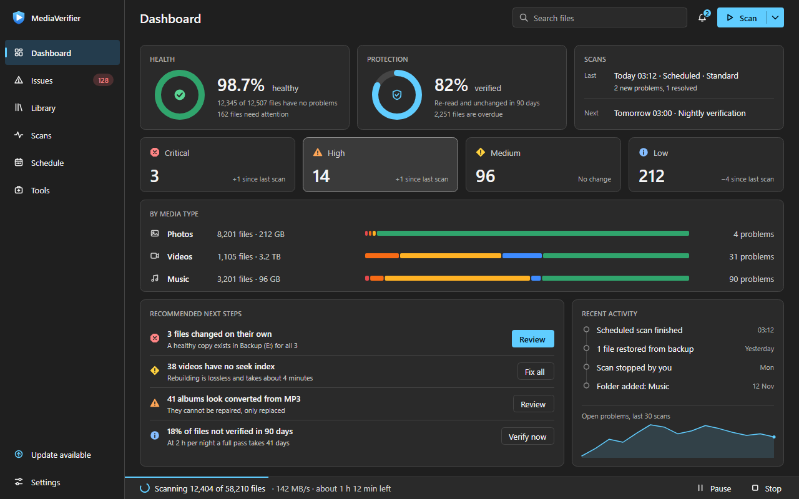

# MediaVerifier

MediaVerifier is a Windows app that checks photo, video and music libraries for damage, bit rot and
fake quality, ranks what it finds, and helps fix it without ever changing a file in place.

**Status: pre-release.** The app is built from the plans in [plans/](plans/README.md); the status board
there shows what is done. There is no public download until the first signed release.

<p align="center">
  
</p>

## What it does

- **Finds damage.** Truncated files, broken containers, decoder errors, embedded checksum failures
  (FLAC, PNG, Ogg), stalled decodes, wrong extensions and unreadable sectors, in photos, video and audio.
- **Finds silent change (bit rot).** Every file gets a fingerprint when first seen and is re-read on a
  schedule. A file whose bytes changed without being modified is flagged, and a verified healthy copy
  in a backup folder can be restored.
- **Finds fakes and quality problems.** Lossless audio made from MP3, upsampled or padded "hi-res"
  audio, clipping and other distortion, video and photos enlarged from a lower resolution, starved or
  inflated bitrates, heavy compression, interlacing marked wrongly, frozen or black video.
- **Ranks everything** as Critical, High, Medium or Low, with a confidence and a plain explanation of
  what it means and what to do ([docs/rules.md](docs/rules.md)).
- **Recommends and repairs.** Restore from a healthy copy, rebuild an index, fix an extension, store
  padded audio at its real depth, save a playable copy of damaged media, quarantine. Every change is
  verified before it replaces anything, keeps the original, is journaled and can be undone.
- **Runs on a schedule** through Windows Task Scheduler with no background process, and tells you only
  about new problems: a Windows notification, the in-app bell, or a webhook.
- **Stays light.** A custom-painted interface, full keyboard and Narrator support, a signed updater.

## First scan in three steps

1. Install the [.NET 10 Desktop Runtime (x64)](https://dotnet.microsoft.com/download/dotnet/10.0) if
   setup asks for it, then run `MediaVerifier-Setup.exe` (or unzip the portable build).
2. Add a folder: **Library → Add folder** (or drop a folder on the Library page). Add your backup drive as a
   *Backup* folder so damaged files can be restored from it.
3. Press **Scan**. A Standard scan reads and decodes everything once; later scans only look at what
   changed, and schedules re-verify fingerprints a little each night.

## What the tiers mean

| Tier | Meaning | Example |
|------|---------|---------|
| Critical | The file is damaged or changed on its own; act now | A FLAC whose bytes changed since it was fingerprinted |
| High | It will not play correctly, or it is not what it claims | A lossless album made from 128 kbit/s MP3 |
| Medium | Worth fixing when convenient | A video without a seek index |
| Low | Informational | A path that other programs may not open |

## What it can and cannot detect

Decoding cannot see every kind of damage, which is why fingerprints matter. Measured rates are in
[docs/detection-rates.md](docs/detection-rates.md).

| Damage | Structure check | Decode | Embedded checksum | Fingerprint |
|--------|-----------------|--------|-------------------|-------------|
| Truncated file | Yes | Yes | — | Yes |
| Missing MP4 index | Yes | Yes | — | Yes |
| 4 KiB of zeros inside FLAC, MP3, AAC, JPEG, PNG | — | Yes | Yes where present | Yes |
| One flipped byte in FLAC, Ogg or PNG | — | Yes | Yes | Yes |
| Random bytes inside H.264 video | — | At Deep depth | — | Yes |
| One flipped byte in JPEG or lossy WebP | — | Often nothing at all | — | Yes |

A clean decode is reported as "no errors found", never as "verified intact"; a fingerprint match is
"unchanged since" its date. No method reliably detects AI upscaling.

## Privacy

No telemetry. MediaVerifier talks to the network only to check GitHub Releases for a signed update
(which you can turn off) and to post to a webhook you set yourself (counts only, no file names).
Your files are only ever read, except by repairs you confirm.

## Documentation

- [docs/rules.md](docs/rules.md): every rule, generated from the catalogue; `F1` in the app opens it.
- [docs/troubleshooting.md](docs/troubleshooting.md): runtime missing, FFmpeg not found, schedules,
  notifications, slow scans, false positives.
- [docs/detection-rates.md](docs/detection-rates.md), [docs/calibration/](docs/calibration/),
  [docs/perf.md](docs/perf.md), [docs/perf-results.md](docs/perf-results.md): measurements.
- [docs/webhook.md](docs/webhook.md), [docs/updater.md](docs/updater.md),
  [docs/path-matrix.md](docs/path-matrix.md), [docs/security-review.md](docs/security-review.md),
  [docs/test-procedures.md](docs/test-procedures.md).
- [THIRD-PARTY-NOTICES.md](THIRD-PARTY-NOTICES.md): the licences of everything shipped.

## Build from source

Requirements: Windows 10 or 11 x64 and the .NET 10 SDK. Integration tests use the bundled FFmpeg
(fetch it with `.\scripts\Get-FfmpegBundle.ps1`) or `MEDIAVERIFIER_FFMPEG_DIR`; generated test media
needs a full FFmpeg on `PATH`. Tests that need either skip themselves.

```powershell
dotnet build MediaVerifier.sln -c Release
dotnet test MediaVerifier.sln
dotnet run --project src/MediaVerifier/MediaVerifier.csproj
.\scripts\Measure-Performance.ps1     # the performance suite and docs/perf-results.md
.\build.ps1 -NoIncrement              # app folder, portable zip and installer in artifacts\
```

C# on .NET 10 with WinForms, framework-dependent single-file with ReadyToRun: the .NET 10 Desktop
Runtime (x64) is the one prerequisite. Media is decoded by a bundled LGPL build of FFmpeg that runs
as separate processes, never in-process, so a corrupt file cannot crash the app; the build contains
no network code. Storage is a bundled SQLite.

## For maintainers

Agents and developers: read [AGENTS.md](AGENTS.md) and [plans/README.md](plans/README.md) first.
Releases follow [plans/14-updater-and-release.md](plans/14-updater-and-release.md): `release.ps1`
bumps the version and tags; the release workflow builds, signs the update manifest with the key held
in the repository secret, and publishes the installer, the portable zip and their checksums. User
visible changes go under *Unreleased* in [CHANGELOG.md](CHANGELOG.md) and become the release notes.

## License

MediaVerifier is released under the [MIT License](LICENSE). It runs FFmpeg as separate programs
under the LGPL 2.1 or later; [THIRD-PARTY-NOTICES.md](THIRD-PARTY-NOTICES.md) lists every bundled component
and its licence.
