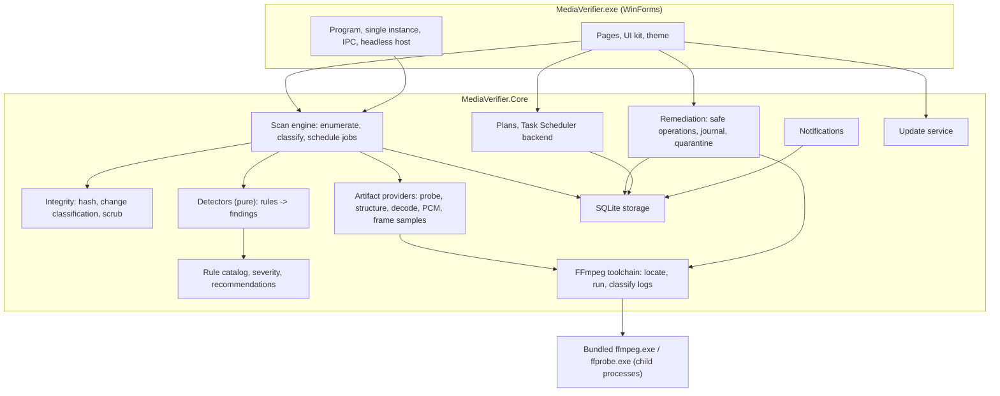

# 00 — Master plan

## 1. Product

MediaVerifier is a Windows desktop app that continuously answers one question about a personal media
library: **is every photo, video and music file still intact, and is it really the quality it claims
to be?**

It scans folders, records a fingerprint of every file, decodes media to find damage, analyses the
decoded signal to find fakes and quality defects, ranks everything it finds into four severity tiers,
explains each finding in plain language, and offers safe tools to fix what can be fixed. It runs
scans on a schedule and notifies the user when something new turns up.

Target user: someone with a large local or NAS library (tens of thousands to a million files) who
wants to know about silent damage before the backups rotate out, and who cares whether a "lossless"
album or a "4K" film is genuine.

Platform: Windows 10 22H2 and Windows 11, x64. Nothing else to install: the app carries its own .NET
runtime, FFmpeg and SQLite, and never downloads components at run time.

## 2. Requirements and where they are addressed

| Requirement (from the project brief) | Addressed in |
|--------------------------------------|--------------|
| Photos, videos, music | 05 (classification), 07, 10, 11 |
| Audio/visual corruption, file corruption | 07 |
| Rot | 06 |
| Quality, fake upscaling, quality matching bitrate | 10 (audio), 11 (video, photo) |
| Clipping / distortion (audio only) | 10 |
| Scheduling | 13 |
| Notifications | 13 |
| Recommendations with built-in remediation tools | 12 |
| Critical, High, Medium, Low tiers | 02 |
| Beautiful, functional, lightweight UI with excellent UX | 08, 09, budgets in section 8 below |
| Built-in updater like FastTaskMgr | 14 |
| Public GitHub repository | Done in phase 0 (`rockenrooster/MediaVerifier`) |
| UI kit and all design decisions specified exactly, not left to the implementer | 08, 09 and the reference mockups in `docs/design/` (D-15) |
| All dependencies self-contained | D-01, D-04, D-05, D-16; bundled FFmpeg in 17 |
| Anything else appropriate | Healthy-copy restore (06, 12), evidence views (09), reports (12), headless mode (13), calibration harness (15) |

## 3. Non-goals for v1

- Not a tagger, organiser, converter, player or duplicate finder. Tools exist only to repair findings.
- No cloud service, account, telemetry or analytics. Network use is limited to update checks and
  optional user-configured webhooks.
- No guarantee of detecting AI-upscaled content. Learned upscalers synthesise plausible detail; the
  detectors here find conventional (interpolation) upscales and say so honestly.
- No full RAW development. RAW files get structural checks and embedded-preview checks only.
- Not cross-platform. Windows-only APIs are used freely.
- No in-process media decoding. See decision D-03.

## 4. Decisions

Each decision is final for v1 unless the repository owner changes it. Rationale is recorded so later
changes are informed.

| ID | Decision | Rationale |
|----|----------|-----------|
| D-01 | C# / .NET 10, WinForms, `win-x64`, nullable enabled, warnings as errors. Published **self-contained** as a single file with ReadyToRun and **without** single-file compression; no trimming | Matches the owner's FastTaskMgr stack, so its updater and UI patterns port directly, while needing no installed runtime. Measured on a WinForms probe with SQLite and hashing referenced: self-contained uncompressed starts in 111–124 ms with 15.5 MB private memory (123.5 MB on disk); compressed is 53 MB on disk but starts in 271–284 ms with 75 MB private memory, because assemblies are unpacked into memory. The installer compresses the download anyway. WinForms and the late-bound COM used for scheduling do not support trimming |
| D-02 | Three projects: `MediaVerifier` (WinForms exe), `MediaVerifier.Core` (engine library, no UI references), `MediaVerifier.Tests` (xUnit) | The engine must be testable and usable headless; single-file publish still yields one exe |
| D-03 | All decoding goes through external `ffmpeg.exe` / `ffprobe.exe` processes. No FFmpeg libraries are loaded in-process | The inputs are corrupt files by definition. A decoder crash or hang must never take the app down, and a stuck decode must be killable. Also avoids unsafe code and native leaks, and keeps FFmpeg licensing separate |
| D-04 | FFmpeg is bundled: our own LGPL 2.1+ build of FFmpeg 9.0.2 with every decoder and demuxer, no network code, no devices and only the encoders and filters the app uses ([subplan 17](17-bundled-ffmpeg.md)). The app uses no other copy | Self-contained, reproducible and identical on every machine, so results do not depend on what the user has installed. A scanned file can never trigger network access. LGPL 2.1+ keeps licence obligations to offering FFmpeg's own source |
| D-05 | Storage is SQLite through `Microsoft.Data.Sqlite.Core` 10.0.9 with `SQLitePCLRaw.bundle_e_sqlite3` 2.1.14, which ships its own SQLite (measured: 3.54.0) as `e_sqlite3.dll` beside the executable | Self-contained and identical on every Windows build, with a modern SQL feature set |
| D-06 | Fingerprints use XXH3-128 from `System.IO.Hashing` | Non-adversarial integrity check; SIMD accelerated and far faster than disk I/O; managed, no native dependency |
| D-07 | Scheduling uses Windows Task Scheduler (per-user tasks) that launch `MediaVerifier.exe --run-plan <id>`. No always-running background process is required | Zero idle footprint; runs even when the app is closed |
| D-08 | Notifications are real Windows toasts raised through a thin WinRT COM interop layer, with a tray balloon fallback and an in-app notification centre | Toasts persist in the notification centre after a headless run exits. Referencing the Windows SDK projection would add roughly 25 MB to the exe |
| D-09 | Remediation never modifies a file in place. It writes a new file, verifies it, then swaps. Originals go to the Recycle Bin or a quarantine folder and every operation is journaled for undo | User media is irreplaceable |
| D-10 | The updater is a direct port of FastTaskMgr's signed-manifest updater (RSA-3072, PKCS#1 v1.5, SHA-256, GitHub Releases, Inno Setup) | Explicit requirement; proven design. See `docs/updater.md` |
| D-11 | Heuristic findings carry a confidence value and use hedged wording ("likely", "possible"). Decode errors and checksum mismatches are stated as fact | Trust: a verifier that cries wolf gets ignored |
| D-12 | Detectors are pure functions over cached analysis artifacts. Artifact providers own all I/O and process execution | Unit tests need no FFmpeg; one FFmpeg run can feed many detectors |
| D-13 | Every numeric threshold lives in one place (`RuleDefaults`), is user-tunable per rule, and is calibrated against a generated fixture corpus | "Measure before changing algorithms"; avoids scattered magic numbers |
| D-14 | Installer is per-user by default (`PrivilegesRequired=lowest`) | Silent updates without a UAC prompt; tasks and registrations are per-user anyway |
| D-15 | The design is specified, not delegated. Subplans 08 and 09 and the mockups in `docs/design/` fix every colour, size, position, icon, state and string; the implementer reproduces them and logs any case they do not cover | The owner asked for every creative and design decision to be spelled out. A specified design can be checked; an improvised one drifts |
| D-16 | Nothing is fetched or required at run time beyond Windows itself. The only operating-system parts relied on are ones every supported Windows 10 and 11 installation has: Win32, GDI and GDI+, the Universal C Runtime, ICU, the Segoe UI and Consolas fonts, Task Scheduler, the notification platform and the shell. Icons are drawn from geometry; no icon font (Segoe Fluent Icons exists only on Windows 11), WebView2, Windows App SDK or Visual C++ redistributable is used | Self-contained, as the owner asked, and works the same on every supported machine |

## 5. Architecture



Data flow for one file:

1. The enumerator finds the file and classifies it by extension (photo, video, audio).
2. Change detection compares size and modified time with the database row and decides what work is due.
3. The integrity stage reads the file once: fingerprint, zero-block scan, read-error capture.
4. Providers produce artifacts on demand: probe result, structure report, decode log, PCM statistics,
   frame-sample metrics. Each artifact is produced at most once per file per run.
5. Detectors evaluate the artifacts and emit findings. Rules assign severity and confidence.
6. The writer persists file state, findings and events in batched transactions.
7. The UI reads snapshots from the database and throttled progress from the engine.

### Solution layout

Target layout. Only `plans/`, `docs/` and the top-level documents exist today; everything else is
created by the tasks in the subplans.

```
MediaVerifier.sln                  (task F-01)
Directory.Build.props              (task F-01; holds the version)
build.ps1, release.ps1             (tasks U-05, U-07)
.github/workflows/ci.yml, release.yml   (tasks F-01, U-07)
.github/workflows/ffmpeg-bundle.yml     (task FFB-04)
installer/MediaVerifier.iss        (task U-06)
deps/ffmpeg/build-ffmpeg.sh        (task FFB-01)
deps/ffmpeg/bundle.lock.json       (task FFB-04)
scripts/New-UpdateSigningKey.ps1   (task U-01)
scripts/Get-FfmpegBundle.ps1       (task FFB-06)
docs/design/                       (exists: mockups, tokens, icons)
docs/updater.md                    (exists)
plans/                             (exists)
src/MediaVerifier/                 WinForms app
  App/            Program glue, AppState, MainForm, IPC host, headless host
  UI/Theme/       tokens, theme service
  UI/Kit/         custom-painted controls
  UI/Pages/       one class per page
  UI/Dialogs/
  Diagnostics/    self-check, screen renderer
  Assets/
src/MediaVerifier.Core/            engine library
  Model/          Severity, MediaKind, Finding, RuleDefinition, ...
  Rules/          catalog, defaults, detectors
  Analysis/       artifacts and providers
  Ffmpeg/         locator, runner, probe model, log classifier, WAV pipe reader
  Engine/         enumeration, pipeline, progress
  Integrity/      hashing, change classification, scrub
  Storage/        database, migrations, repositories
  Remediation/
  Scheduling/
  Notifications/
  Updates/
  Settings/
  Util/
tests/MediaVerifier.Tests/
```

## 6. Vocabulary

| Term | Meaning |
|------|---------|
| Root | A folder the user added. Role is `Library` (fully analysed) or `Backup` (fingerprinted only, used as a source of healthy copies) |
| Run | One execution of the engine over a scope, started manually or by a plan |
| Depth | How much work a run does per file: `Quick`, `Standard`, `Deep` (section 7) |
| Baseline | The stored fingerprint, size and modified time of a file at the last time it was known good |
| Verification | Re-reading a file and comparing its fingerprint to the baseline |
| Scrub | The policy that re-verifies every file at least once per period within a time budget |
| Artifact | A cached analysis result for one file (probe, structure, decode, PCM stats, frame samples) |
| Provider | Code that produces an artifact; may read files and start processes |
| Detector | Pure code that turns artifacts into findings |
| Rule | Catalog entry describing one kind of finding: ID, category, severity policy, explanation, fixes |
| Finding | One rule violation on one file, with severity, confidence and evidence |
| Plan | A saved, schedulable scan definition |
| Operation | A journaled remediation action that can be undone where possible |

## 7. Scan depth

| Depth | Work per file | Typical cost | Finds |
|-------|---------------|--------------|-------|
| Quick | Stat, magic/structure checks, `ffprobe`. Fingerprint only for new or changed files | Milliseconds plus one read for new files | Unreadable, empty, truncated, unrecognised, wrong extension, broken containers, starved bitrates |
| Standard (default) | Quick, plus: full audio decode with signal analysis; full photo decode; video demux of the whole file with keyframe decode, audio decode and sampled-frame quality metrics | Roughly 0.3 s per track or photo; seconds to a minute per film (I/O bound) | Everything in Quick, plus decode errors, checksum mismatches, clipping, fake lossless, upsampling, fake upscaling, compression artifacts |
| Deep | Standard, plus: every video frame decoded, strict error detection, freeze and black detection | Minutes per film | Damage inside non-key frames, long freezes |

Fingerprint verification is governed by the scrub policy (subplan 06), not by depth. A run at any depth
also verifies files that are due.

## 8. Budgets

These are requirements, verified in subplan 16. Measure before optimising.

| Metric | Budget |
|--------|--------|
| Installed size (app folder: self-contained exe, `e_sqlite3.dll`, `ffmpeg\`) | 200 MB or less (expected: about 125 MB exe, 2 MB SQLite, at most 60 MB FFmpeg) |
| Installer download | 90 MB or less |
| Cold start to interactive window | 500 ms or less on an SSD (the self-contained probe measured 111–124 ms) |
| Idle CPU with the window open and no scan | 0 % (no polling timers on hidden pages) |
| Idle private memory, 100,000-file database | 80 MB or less (the probe measured 15.5 MB) |
| Background processes when the app is closed | None |
| List scrolling with 1,000,000 rows | No dropped frames at 60 Hz; no per-row allocations while scrolling |
| Enumeration | 50,000 files/s or more on SSD |
| Database write throughput | 5,000 file rows/s or more |
| Fingerprint throughput | Limited by storage, not CPU (1 GB/s or more on NVMe) |
| Engine overhead excluding FFmpeg children | Under 5 % of one core |
| Memory during a scan | 400 MB or less, independent of library size |
| UI thread | Never blocked longer than 50 ms; no synchronous disk or process work |

## 9. Phases and milestones

| Phase | Subplan | Depends on | Exit in one line |
|-------|---------|-----------|------------------|
| 0 | Repository and plans (done) | — | Public repository with these plans. No code |
| 1 | 01 Foundation | 0 | Solution skeleton, then a shell window with navigation, settings, logging, single instance, self-check |
| 2 | 02 Findings model | 1 | Model types and full rule catalog compile with tests |
| 3 | 03 Storage | 2 | Schema v1, migrations, repositories, query layer tested |
| 4 | 04 FFmpeg toolchain | 1 | Bundle located and checked; runner, probe model and log classifier tested |
| 5 | 05 Scan engine | 3, 4 | A run enumerates, schedules, persists and reports progress; resumable |
| 6 | 06 Integrity and rot | 5 | Baselines stored; modified, rotted, moved and missing files classified correctly |
| 7 | 07 Corruption detectors | 5 | Corruption matrix passes at all three depths |
| 8 | 08 UI design system | 1 | Theme tokens, UI kit and screen renderer pass contrast and render checks |
| 9 | 09 UI screens | 3, 8 | All pages functional against the real engine |
| 17 | 17 Bundled FFmpeg | — | Our LGPL FFmpeg 9.0.2 build published with its source and pinned in the lock file |
| — | **M1 (MVP)** | 1–9, 14, 17 | Scan, find corruption and rot, review in UI, self-update. First public release |
| 10 | 10 Audio quality | 7 | Audio authenticity and distortion rules pass calibration |
| 11 | 11 Video and photo quality | 7 | Upscale and bitrate rules pass calibration |
| — | **M2** | 10, 11 | Full detection suite with evidence views |
| 12 | 12 Remediation | 9 | Recommendations and repair tools with journal and undo |
| — | **M3** | 12 | |
| 13 | 13 Scheduling and notifications | 9 | Plans run headless on schedule and raise toasts |
| — | **M4** | 13 | |
| 14 | 14 Updater and release | 1 | Signed update check, download, install; release pipeline green |
| 15 | 15 Testing and calibration | continuous | Fixture generator, corruption matrix and calibration report maintained |
| 16 | 16 Hardening | all | Budgets met, robustness and accessibility passes done. **v1.0** |

Parallel work that is safe: phase 8 alongside phases 2–7; phase 14 any time after phase 1; phase 17
at any time (until it lands, developers point `MEDIAVERIFIER_FFMPEG_DIR` at a local FFmpeg 8.0 or
newer); phase 9 against fake data once phases 2 and 8 exist. Phases 10 and 11 are independent of each
other, as are 12 and 13.

Version plan: `0.1.x` for M1, `0.2.x` for M2, `0.3.x` for M3, `0.4.x` for M4, `1.0.0.0` after phase 16.

## 10. Engineering rules

These apply to every task.

**Quality**

- Low overhead, fast, efficient code. No memory or handle leaks. Dispose what you create.
- New features must not break existing behaviour. Keep the build green and tests passing after every
  commit.
- All long work is asynchronous and cancellable. The UI thread never performs I/O or waits on a process.
- Measure or reason about a bottleneck before changing an algorithm. Prefer SIMD-capable library
  routines (`System.IO.Hashing`, `System.Numerics.Tensors`, `Span` search helpers) and keep a scalar
  fallback path working.
- Small, focused commits. Do not touch unrelated files.
- Before a major or potentially breaking refactor, copy the affected source tree to
  `Backup_pre-<topic>-<yyyyMMdd-HHmmss>/` at the repository root (ignored by git).

**Correctness**

- Never trust a process exit code alone. FFmpeg and ffprobe return 0 for many corrupt files; classify
  their log output (appendix A).
- Never claim certainty for a heuristic. Set confidence honestly and use the wording rules in subplan 02.
- All parsing and formatting of numbers in files, logs, JSON and SQL uses `CultureInfo.InvariantCulture`.
- Paths: support Unicode and paths longer than 260 characters. Pass arguments to child processes only
  through `ProcessStartInfo.ArgumentList`; never build a command line string and never use a shell.
- User media is read-only to everything except the remediation module, and that module follows the
  safe-operation protocol in subplan 12 without exception.
- Do not trigger cloud-file hydration. Skip placeholder files unless the user opts in (subplan 05).

**UI**

- Build exactly what subplans 08 and 09 and `docs/design/` specify. Do not introduce colours, sizes,
  icons, layouts or wording of your own; log any case the specification does not cover (D-15).
- Human readable and space-efficient.
- Every interactive element has clearly visible, high-contrast hover, pressed, focused and disabled
  states that follow the tokens in subplan 08.
- Every action is reachable by keyboard. Colour is never the only signal; severity always has an icon
  and a text label.

**Security and privacy**

- No secrets in the repository. The update signing private key lives only in the GitHub Actions secret
  and in the owner's local `artifacts/` folder, which is ignored by git.
- Downloads (app updates at run time; the FFmpeg bundle at build time) are verified by size and
  SHA-256 before use and fail closed.
- No telemetry. Logs stay on the machine.

**Dependencies**

Everything the app needs ships inside its folder (D-01, D-04, D-05, D-16).

- NuGet packages for the product: `Microsoft.Data.Sqlite.Core` 10.0.9, `SQLitePCLRaw.bundle_e_sqlite3`
  2.1.14, `System.IO.Hashing`, `System.Numerics.Tensors`. Pin exact versions.
- Native files beside the executable: `e_sqlite3.dll` (from the package above) and the `ffmpeg\`
  folder (subplan 17). Nothing else.
- Adding any other dependency requires a deviations-log entry explaining why the platform cannot do it,
  and it must also ship inside the app folder.
- Never download, install or look for a component at run time. Never rely on optional Windows
  components.
- Test projects may use `xunit`, `Microsoft.NET.Test.Sdk` and `xunit.runner.visualstudio`, and a
  full FFmpeg build on the developer's `PATH` for generating fixtures (subplan 15).

## 11. Definition of done

A task is done when:

1. Its acceptance criteria pass.
2. `dotnet build MediaVerifier.sln -c Release` produces no warnings.
3. `dotnet test MediaVerifier.sln` passes (integration tests may skip when no FFmpeg bundle or
   override is available, never fail).
4. Once `build.ps1` exists (task U-05): `.\build.ps1 -NoIncrement` succeeds and
   `artifacts\MediaVerifier\MediaVerifier.exe --self-check` exits 0. Before that, run the self-check on
   the built exe.
5. User-visible changes are in `CHANGELOG.md` under `Unreleased`.
6. The status board in `plans/README.md` is current.

## 12. Risks

| Risk | Impact | Mitigation |
|------|--------|------------|
| False positives in heuristic rules erode trust | High | Confidence values, conservative defaults, calibration corpus (15), per-rule tuning and ignore |
| FFmpeg log text differs between versions | Medium | One bundled version; classifier matches message cores, not prefixes; captured log corpus re-run on every FFmpeg update (17) |
| The FFmpeg build image or source archive disappears upstream | Low | Image pinned by digest; source mirrored into our own release; built bundles stay in our releases, so only a version change needs a rebuild (17) |
| Installed size is larger than a framework-dependent app | Low | Measured and budgeted; uncompressed single file chosen for start time and memory; the installer compresses (D-01) |
| Full-library first scan takes many hours | Medium | Depth choice, time estimates before starting, resumable runs, per-volume I/O policy, scrub budgets |
| Remediation damages a file | Critical | Never in place; verify before swap; journal and undo; packet-hash equality check for remuxes (12) |
| Toast interop fails on some Windows builds | Low | Balloon fallback and in-app notification centre; self-check exercises the path |
| Custom-painted WinForms UI drifts from the design | Medium | Token-driven kit, contrast unit test, `--render-screens` harness compared with the reference mockups after each UI task (08) |
| Tools that edit tags while preserving the modified time look like rot | Medium | Stream-hash comparison separates payload changes from metadata changes (06) |
| Corrupt file makes a decoder loop or run extremely slowly | Medium | Idle and hard timeouts, kill on timeout, `COR-HANG` finding (04, 07) |

## 13. Open items for the repository owner

These do not block implementation.

1. **Licence.** No licence file is included, mirroring FastTaskMgr. Add one before inviting contributions.
2. **Update signing key.** Once task U-01 has added `scripts/New-UpdateSigningKey.ps1`, run it with
   `-SetGitHubSecret` once on the owner's machine (subplan 14). An implementing agent in a sandbox
   must not generate the production key.
