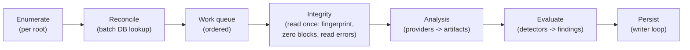

# 05 — Scan engine

Phase 5. Depends on: phases 3 and 4. Unblocks: integrity, detectors, UI.

## Goal

The engine that walks roots, decides what work each file needs, runs that work with sensible
concurrency for the storage it lives on, persists results, and reports progress. It must be
resumable, cancellable, and safe to kill at any moment.

This phase builds the machinery with fake providers. Real analysis arrives in subplans 06, 07, 10, 11.

## Media classification

By extension first (lower case); refined after probing.

| Kind | Extensions (defaults, user-editable) |
|------|--------------------------------------|
| Photo | `jpg jpeg jpe jfif png gif bmp tif tiff webp heic heif avif jxl jp2` and RAW: `dng cr2 cr3 nef arw orf rw2 raf pef srw` |
| Video | `mp4 m4v mkv webm mov avi wmv asf flv mpg mpeg m2v vob ts m2ts mts 3gp 3g2 ogv divx mxf rm rmvb f4v` |
| Audio | `mp3 flac wav m4a aac ogg oga opus wma aiff aif ape wv tta mka ac3 dts mp2 amr dsf dff mpc caf au` |

RAW photos receive structural and embedded-preview checks only. Files with other extensions are
ignored and not indexed.

## Enumeration

- Use `System.IO.Enumeration.FileSystemEnumerable<T>` with a transform that captures name, size,
  attributes and last write time without allocating `FileInfo`.
- One enumerator per root; roots on the same physical volume are enumerated sequentially.
- Default exclusions (directory names, case-insensitive, user-editable): `$RECYCLE.BIN`,
  `System Volume Information`, `.mediaverifier-quarantine`, `@eaDir`, `.@__thumb`, `#recycle`,
  `.Trash*`, `lost+found`, `.git`. Skip reparse points (junctions, symlinks) by default to avoid loops.
  Skip hidden+system files.
- Per-root include and exclude globs apply to the path relative to the root.
- A root whose path does not exist or cannot be listed is **offline**: raise `RUN-ROOT-OFFLINE`, touch
  none of its rows, continue with other roots.
- A subdirectory that fails to list (access denied, I/O error) is recorded in the run's errors, and
  its files are excluded from missing-file detection for this run.

### Files that are skipped

A skipped file keeps its row with `state = Skipped` and a reason; it is not a finding.

| Reason | Condition |
|--------|-----------|
| `CloudPlaceholder` | Attributes include `FILE_ATTRIBUTE_RECALL_ON_DATA_ACCESS` (0x400000), `RECALL_ON_OPEN` (0x40000) or `OFFLINE` (0x1000). Opt-in setting *Scan online-only cloud files* reads them (and warns it will download them) |
| `InProgress` | Modified less than 2 minutes ago, or a sibling partial-download marker exists (`.part`, `.crdownload`, `.!qB`, `.!ut`, `.tmp`). Re-checked once at the end of the run |
| `Locked` | Sharing violation on open; retried once at the end of the run |
| `AccessDenied` | Access denied |
| `TooLarge` | Above the optional size limit |
| `UnsupportedByFfmpeg` | No decoder for it in the bundled FFmpeg (subplan 04) |

### Path checks (`GEN-PATH`, M3)

Evaluated from the enumerated name alone, no I/O. Low severity when any of these holds: the full path
is longer than 259 characters; a file or folder name ends with a space or a dot; a name is a reserved
device name (`CON`, `PRN`, `AUX`, `NUL`, `COM1`–`COM9`, `LPT1`–`LPT9`, with or without an
extension). Such files work here but break in Explorer, many players and many backup tools. Evidence
names which condition and which path segment.

## Reconciliation: what work does a file need?

For each enumerated file, compare with its index row.

| Situation | Detection | Work |
|-----------|-----------|------|
| New | No row | Insert; baseline fingerprint; analysis at run depth |
| Unchanged | Same size and modified time | Analysis only if `scanned_depth < run depth`; rule re-evaluation only if `detector_set` is behind (no I/O, see below); verification only if due under the scrub policy |
| Modified | Size or modified time differs | `Modified` event; new baseline; full re-analysis; findings re-evaluated from scratch |
| Returned | Row was `Missing` | `Returned` event; the row leaves `Missing` (its state follows its findings again, `Pending` if never analysed); then as Unchanged or Modified |
| Missing | Row not seen in this run, root online, directory listed successfully | `state = Missing`, `Missing` event. Rows are kept for history |
| Out of scope | Row not seen in this run, and the current rules leave it out (a skipped folder name, the folder's exclude or include patterns, a file type no longer in the lists, a kind the folder no longer contains) | The row is deleted with its findings, artifacts and history; it is not missing and does not count toward `RUN-MASS-MISSING` |
| Moved | A new path whose NTFS file ID, size and modified time match a row that would otherwise go missing in the same root | Update the row's directory and name; `Moved` event; no re-analysis. Fallback after hashing: fingerprint equals a row that went missing in this run |

Reconciliation runs in batches (one lookup query per directory).

### Re-evaluation without re-decoding

Providers persist a compact summary of each artifact (numbers only, a few hundred bytes) in the
`artifacts` table. Detectors are pure functions over artifacts, so when a rule's logic, a threshold or
a user override changes, findings are recomputed from stored artifacts with no file I/O. A provider
has its own version; analysis is repeated only when the **provider** version is behind or the file
changed. This is what makes threshold tuning on the Settings page instant.

## Pipeline



Stages are connected by bounded `System.Threading.Channels`; a slow stage applies back-pressure
instead of buffering the library in memory.

### Work ordering

Within a run, work is taken in this priority, and in directory order within each class to keep disk
access sequential:

1. New and modified files.
2. Verification that is due, least recently verified first.
3. Depth upgrades and provider-version upgrades.

With a time budget (scheduled runs), the engine stops taking new work when the budget is reached, lets
in-flight files finish, and ends the run as `BudgetReached`. Work still queued is dropped and the
listing stops; a root whose listing did not finish has no missing-file detection in that run. The next
run continues naturally because work is derived from state.

### Concurrency

Two independent limits.

**I/O gate, one per physical volume.** Limits how many readers touch a volume at once.

| Storage class | Concurrent readers (default) | How detected |
|---------------|------------------------------|--------------|
| HDD | 1 | `IOCTL_STORAGE_QUERY_PROPERTY` with `StorageDeviceSeekPenaltyProperty` reports a seek penalty |
| SSD / NVMe | 4 | No seek penalty |
| Network share | 2 | UNC path or `DriveType.Network` |
| Removable | 1 | `DriveType.Removable` |
| Unknown | 2 | Query failed (storage pools, some USB bridges) |

Values are user-adjustable per root. Volumes are identified by volume GUID path, so two drive letters
or folders on one disk share a gate.

**CPU gate, global.** A weighted semaphore with capacity = logical cores × performance level
(Low 25 %, Balanced 50 %, High 100 %; default Balanced, minimum 1).

| Job | Weight | FFmpeg `-threads` |
|-----|--------|-------------------|
| Probe | 1 | 1 |
| Audio decode and analysis | 1 | 1 |
| Photo decode | 1 | 1 |
| Video, Standard pass | min(4, capacity) | same as weight |
| Video, Deep pass | min(8, capacity) | same as weight |

**Read once, then analyse from cache.** For a file of 256 MiB or less the integrity stage reads it
under the I/O gate (producing the fingerprint as a by-product, which also counts as a verification),
releases the gate, and hands it straight to analysis; FFmpeg then reads it from the OS file cache
without disk seeks. Larger files (most video) hold the I/O gate for the duration of their FFmpeg run.
On an HDD this serialises big files and keeps small-file analysis parallel.

### File context and artifacts

```csharp
sealed class FileContext
{
    public string Path { get; }
    public MediaKind Kind { get; }
    public FileStat Stat { get; }            // size, times, attributes, NTFS id
    public FileRow? Previous { get; }        // index row before this run
    public ScanDepth Depth { get; }
    public string TempDirectory { get; }
    public CancellationToken Cancellation { get; }
    public ValueTask<T> GetAsync<T>() where T : class, IArtifact;   // runs the provider at most once
}

interface IArtifactProvider<T> where T : class, IArtifact
{
    int Version { get; }
    ScanDepth MinDepth { get; }
    bool Applies(FileContext file);
    Task<T> ProduceAsync(FileContext file);
}

interface IDetector
{
    IReadOnlyList<string> RuleIds { get; }
    ScanDepth MinDepth { get; }
    bool Applies(FileContext file);
    ValueTask EvaluateAsync(FileContext file, IFindingSink sink);   // pure with respect to artifacts
}
```

Rules for providers:

- A provider never throws for bad media. Process failures, timeouts and unsupported formats are data
  in the artifact (`Outcome` field), so detectors can raise `COR-HANG` or mark the file skipped.
- An unexpected exception (a bug) sets the file to `state = Error` with the message, increments the
  run's error count, and the run continues.
- Each provider cleans its temp directory.

## Run lifecycle

1. Insert a `runs` row with status `Running`. Acquire the engine mutex.
2. Enumerate and reconcile while work already flows (do not wait for enumeration to finish).
3. Checkpoint counters to the run row every 5 seconds.
4. When all stages drain: mark missing files, evaluate run-level alerts, write the summary, set the
   final status, checkpoint the WAL, release the mutex, raise `RunCompleted`.

Control:

- **Pause**: stop taking new work. In-flight files get 10 seconds to finish, then are cancelled and
  re-queued. The UI shows "Pausing, finishing N files".
- **Cancel**: cancel everything, wait for children to exit, final status `Cancelled`. Completed files
  keep their results.
- **Crash or kill**: at next start any run still marked `Running` becomes `Interrupted` and the UI
  offers *Resume*, which starts a new run with the same scope. No special resume state is needed.
- Only one run at a time. A second request while one is active is queued (manual) or skipped with a
  logged reason (scheduled).

Partial scopes (rescan a folder or selected files) are first-class: missing-file detection applies
only inside the directories actually enumerated. Selected files ("Scan again") are not reconciled:
each one still present is read and analysed from scratch at the run's depth, stored artifacts are
not reused, only those files count as seen, and missing-file detection does not run. When a write
the run posted without waiting (a seen mark) fails, the run marks nothing missing; the next run does.

## Progress and estimates

The engine exposes an immutable `EngineStatus` snapshot that the UI polls at up to 10 Hz. It never
raises per-file UI events.

Fields: phase (`Enumerating`, `Scanning`, `Finishing`, `Paused`), files seen / queued / done / skipped
/ failed, bytes read and smoothed read rate, counts per media kind, new findings per severity, up to
eight in-flight items (path, stage, fraction), elapsed time, estimated remaining time.

Estimates: remaining bytes ÷ smoothed read rate for integrity work, plus remaining files per kind ×
an exponentially weighted average of observed analysis time per kind and depth. Persist those averages
per storage class between runs so that a **pre-scan estimate** can be shown once enumeration finishes
("about 3 h 20 min at Standard depth"). Show "estimating" until at least 50 files or 30 seconds of
data exist. Never show an estimate that jumps wildly: clamp change to ±20 % per update.

## Engine API

```csharp
interface IScanEngine
{
    EngineStatus Status { get; }
    event Action<RunCompleted>? RunCompleted;
    Task<long> StartAsync(ScanRequest request);     // returns the run id
    void Pause();
    void Resume();
    void Cancel();
}

sealed record ScanRequest(
    IReadOnlyList<ScanScope> Scopes, ScanDepth Depth, RunTrigger Trigger,
    long? PlanId = null, TimeSpan? Budget = null, ScanOptions? Options = null);

sealed record ScanScope(long RootId, string? RelativeDirectory = null, IReadOnlyList<long>? FileIds = null);
```

## Tasks

| ID | Task | Acceptance |
|----|------|------------|
| E-01 | Extension classifier with user-editable lists | Tests for case, multi-dot names, unknown extensions |
| E-02 | Enumerator with exclusions, globs, reparse-point and attribute handling | Temp-tree tests incl. junction loop, excluded dirs, access-denied subdirectory. Measured 50,000 files/s or more on SSD |
| E-03 | Skip rules (placeholder, in-progress, locked, too large) with end-of-run retry | Tests set attributes and locks explicitly |
| E-04 | Reconciler covering every row of the reconciliation table, in batches | Table-driven tests incl. move detection by NTFS id and by fingerprint, returned files, offline root leaves rows untouched |
| E-05 | Storage-class detection and per-volume I/O gates | Unit test with a fake volume resolver; integration test asserts the reported class for the system drive |
| E-06 | Weighted CPU gate and performance levels | Instrumented fake provider proves the weight sum never exceeds capacity |
| E-07 | Pipeline with bounded channels, ordering and the read-once rule | Tests: back-pressure holds memory flat with 1,000,000 synthetic files; max concurrent readers per volume is respected |
| E-08 | `FileContext`, artifact cache, provider and detector registries, artifact persistence and re-evaluation without I/O | Tests: provider runs once when three detectors request it; changing a threshold re-evaluates from stored artifacts with zero provider calls |
| E-09 | Run lifecycle: checkpoints, missing detection, alerts, summary, interrupted-run recovery | Kill the test host mid-run; next start marks the run interrupted; resume completes with correct totals and no duplicate rows |
| E-10 | Pause, resume, cancel, budget | Tests with slow fake providers |
| E-11 | `EngineStatus`, throughput smoothing, estimates, persisted averages | Estimate stays within the clamp; unit tests on the estimator with synthetic rates |
| E-12 | Fault isolation: provider bug, process timeout, disk removed mid-run, database busy | Each fault leaves the run alive (or cleanly failed for disk removal) and the database consistent |
| E-13 | Headless host: run a `ScanRequest` without UI and return an exit code (0 success, 1 failure, 3 forwarded to a running instance) | Used by subplan 13 and by integration tests |
| E-14 | `GEN-PATH` detector (M3) | Table-driven tests for each condition; a 300-character path and a folder named `aux` are flagged, ordinary paths are not |

## Exit criteria

- A run over a 1,000,000-file synthetic tree with fake providers completes with flat memory (under
  400 MB) and engine CPU overhead under 5 % of one core excluding providers.
- Killing the process at random points 20 times never corrupts the database or loses a completed
  file's results.

## Pitfalls

- Modified time resolution differs: NTFS 100 ns, exFAT 10 ms, FAT 2 s, some NAS shares round to 1 s
  or 2 s. Compare with a tolerance of 2 s unless the size also changed.
- Daylight-saving shifts on FAT volumes move local timestamps by an hour; store and compare UTC, and
  treat an exact ±1 h difference with identical size on a FAT/exFAT volume as unchanged.
- `FileSystemEnumerable` reports reparse points as directories; check attributes before recursing.
- Do not hold the I/O gate while waiting for the CPU gate (deadlock and starvation); acquire CPU first
  for large-file jobs, then I/O.
- Never mark files missing when a root is offline or enumeration failed part-way.
